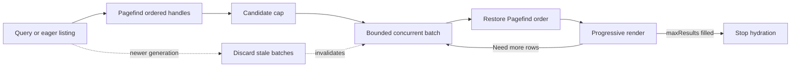

# Hawk architecture

Hawk is a themeable, pluggable command-palette search UI for static sites. It owns the modal,
keyboard navigation, and result rendering; it delegates indexing/ranking to
[Pagefind](https://pagefind.app/) and delegates visual identity and reveal animation to plugins.

- [`plugin-system.md`](./plugin-system.md) — how theme and animation plugins register and resolve.
- [`theme-interface.md`](./theme-interface.md) — what a theme is allowed to assume/do.
- [`animation-driver-interface.md`](./animation-driver-interface.md) — the interface an animation driver implements.

## Why Pagefind instead of a hand-rolled index

Hawk was extracted from typeflow's docs site search, which built its index client-side from one
JSON blob of every page's raw content and scored matches with a hand-rolled additive weighting
scheme. That worked at typeflow's doc-set size (~16 pages) but doesn't hold up past a few hundred
pages, and has no typo tolerance. Pagefind was prototyped against typeflow's built docs site and
validated (see the org's typeflow session notes) before this package existed: correct topic
ranking, typo-tolerant matching, and a chunked/lazily-loaded index that only grows the *fetch
cost* per query, not per corpus size. Hawk never re-implements indexing or ranking — it only
renders what Pagefind returns.

## Why no `Hawk.use()`

There's no plugin-registration precedent anywhere else in this org to imitate — typeflow's own
"extensions" (metrics, debug, webaudio, keystroke, extchars) are either standalone classes that
poll `TypeFlow.active`, or (for framework adapters) plain factory functions the consumer calls
directly with their framework's runtime. Hawk's plugin system (`HawkSearch.registerTheme` /
`HawkSearch.registerAnimation`) is new design, not a port — see `plugin-system.md` for the
reasoning that shaped it.

Hawk's own `debug`/`metrics` extras (`@staticcanvas/hawk/debug`, `@staticcanvas/hawk/metrics`,
added after this note was first written) followed `@staticcanvas/lume`'s shape instead of
typeflow's: `createHawkDebug(hawk, options)` / `createHawkMetrics(hawk, options)` factory
functions that wrap `HawkSearch`'s already-public methods/callbacks and poll its public `state`
getter, rather than a new registration mechanism or any change to `hawk.js` itself. Non-invasive
by construction — the same reason there's no `Hawk.use()`.

## Bounded result hydration

Pagefind owns index selection and ranking, but its search response contains lightweight result
handles. Hawk must call each handle's `data()` method before it can render that page and its heading
matches. Those independent fragment requests run through a bounded concurrency pool so neither a
high-latency connection nor an extreme result set turns Hawk into a serial waterfall or an
unbounded request fan-out.

`resultHydrationConcurrency` bounds active fragment loads (default 6), while
`maxCandidateResults` bounds how many handles Hawk will inspect when excluded pages prevent
`maxResults` from filling (default `maxResults * 3`). Rendering happens only at completed batch
boundaries, preserving Pagefind order and preventing partial out-of-order rows. Search-generation
checks run after every batch so an older query can never overwrite newer results.
